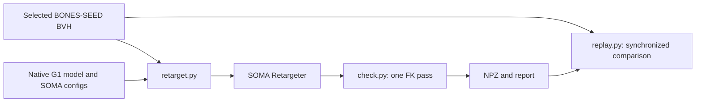
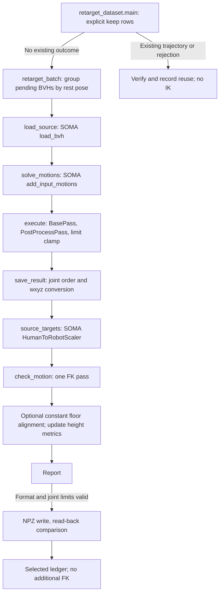

# Architecture and Pipeline

```text
robots/g1_23dof/   Official model, meshes, SOMA configs, verification reports
motions/source/   BONES-SEED BVHs, metadata, screened selection
motions/g1_23dof/  Reference NPZs and processing records
motions/g1_29dof/  Official reference and reproduction CSVs, validation only
tools/            Preparation, selection, retargeting, checking, replay
docs/             Architecture and operations
```



## Responsibilities

| Component | Responsibility |
| --- | --- |
| BONES-SEED | BVH animation and descriptive metadata |
| SOMA | BVH parsing, coordinate conversion, scaling, IK, contact inference/correction, limit clamping |
| Unitree | Native 23DoF MJCF, URDF and 29 meshes; assets unchanged |
| MuJoCo | Model loading, FK, enabled collision pairs and viewer |
| Project | Native configuration, selection, output conversion, diagnostics and storage |

`manifest.json` registers the model. `retargeter.json` maps human targets to robot links and sets IK weights. `scaler.json` contains the reference pose, scale and local offsets. `post_processing.json` configures SOMA correction. `checks.json` retains the original diagnostic thresholds; these are not official safety limits.

The model has 12 leg joints, waist yaw and 10 arm joints: nq=30, nv=29, nu=23. Physical revision and payload remain unconfirmed. Hand targets are rubber-hand link origins, not measured palm centers. Foot targets are ankle-roll frames. Reference alignment is verified; general motion fidelity requires review.

## Actual Calls



Only format errors and model joint-limit violations are hard failures. Speed, saturation, foot penetration/sliding/contact and enabled self-collision thresholds produce review warnings. Saved trajectories still require task-fit review; a reference file is not a controller-approved motion. Old reports retain their original acceptance semantics. The selected driver records new warnings as `review` and declared URDF speed violations as `skipped_velocity`; neither stops other files. Configuration verification, rather than success of every motion, gates selected processing. Comparison-only results are preserved as `skipped_review`.

Hand/foot errors compare robot FK with SOMA-scaled, offset source targets before contact post-processing. Statistics are mean, P95, maximum and worst frame for position (m) and orientation (rad). They measure task expression, not the residual against corrected foot targets. Constant floor translation is applied equally to the comparison frames. There is no invented error threshold or torso-angle cutoff.

The native model has no waist pitch/roll. Hip/knee/ankle compensation may express mild bends; missing-DOF dependence must be assessed from motion fit and replay. Object clips provide poses, not validated grasping, object forces or payload capacity. No dynamic balance validation is performed.

New generation uses pure SOMA. Historical custom arm-adaptation results are preserved for read-only inspection; new custom-adapted runs are blocked.

SOMA's `smooth_joint_filter_weight` controls a near-limit penalty, not temporal smoothing. Its existing limb stabilizer supports hand chains through configuration; it does not establish collision-free or dynamically stable motion.

## Tools

| File | Purpose |
| --- | --- |
| download_dataset.py | Pinned source download, hash verification and extraction |
| download_sample.py | Compatibility notice directing callers to the consolidated downloader |
| select_motions.py | Metadata-only keep/exclude/review decisions |
| check_model.py | Native model structure and loading check |
| verify_official.py | Pinned official BVH/29DoF CSV reproduction with unchanged SOMA settings |
| retarget.py | Single-motion and compatible-batch SOMA solves, with per-motion checks and saving |
| retarget_dataset.py | Explicit selected-list driver; reuse, progress and audit |
| check.py | One-pass metrics; optional source-target review of existing trajectories without IK |
| compare_upper_body.py | Three authorized clips; isolated SOMA weight comparison using the shared pipeline |
| replay.py | Original human and robot synchronized playback |

## NPZ

Meters, radians, seconds; right-handed world, X forward, Z up.

| Field | Shape or meaning |
| --- | --- |
| timestamps | T source timestamps |
| root_pos | T × 3 world position |
| root_quat | T × 4, wxyz |
| joint_pos / joint_names | T × 23 / ordered names |
| source_foot_contact | T × 2 inferred contact weights, when available |
| metadata_json | Source, configuration and software provenance |
| check_report_json | Checks, warnings and target error diagnostics |
